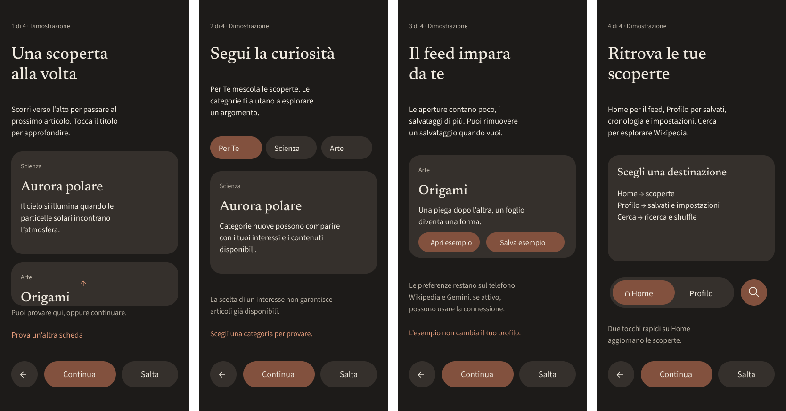

# Onboarding Patch — fase A, consegna per Antigravity

11 ottobre 2026. Progetto `synapse-mobile`, nella radice Git `C:/Users/Augusto/Documents/Scrolls`. **Ramo `onboarding-patch`**, derivato da `e9a5fee`, consegna verificata della Category Patch. Non si è presunto che la patch fosse su main. La fase B non è stata avviata. Il design e le decisioni funzionali appartengono a Codex; Antigravity implementa questa specifica.

**Versione prevista dopo modifiche e conferma finale: 0.1.13.** In A restano package/app 0.1.12, Android code15. Non incrementare in B; Codex controlla versione e codice effettivamente installati prima della release C. Nessun push, reset, merge o riscrittura della cronologia.

## Stato iniziale, checkpoint e modifiche preesistenti

TypeScript e 185 test passavano prima dell'intervento. La Category Patch è presente nel catalogo canonico, classificazione, registro, migrazione, recupero e schermate; il rapporto storico è `CATEGORY-PATCH-0.1.12-REVIEW.md`. Il documento condiviso GIT-COLLABORATION contiene un'affermazione storica «Category Patch non implementata», superata dai commit successivi.

Esistevano modifiche locali in questi nove file, preservate integralmente e **escluse dal commit A**:

- AGENTS.md; App.tsx; src/components/CategoryRail.tsx; src/components/Feed.tsx.
- src/content/settings.ts; src/content/types.ts.
- tests/category-ui-visual.test.cjs; tests/content.test.cjs; tests/feed-gesture-ui.test.cjs.

Riguardano sfumature Home/barra e interruttore auto-hide. Il checkpoint recuperabile locale è `../.git-preparation/onboarding-preexisting/local.patch`, con `base.txt` e copia dell'App iniziale. L'App è un file condiviso: nel commit si registrano soltanto gli inserimenti A, mentre le modifiche anteriori rimangono nel working tree. **Non ripristinare questi nove file per ottenere un checkout pulito.** Antigravity lavora nello stato locale concordato; legge prima `git status`, `AGENTS.md` e questa consegna. Il commit A identifica le nuove fondamenta, non sostituisce il checkpoint locale delle modifiche anteriori.

## Flusso e invarianti

`intro → identity → interests → tutorial[0..3] → preparation → home`.

| Controllo | Comportamento |
| --- | --- |
| Continua | Salva lo stato, poi avanza di un passo; identity e interests possono essere vuoti. |
| Salta nome/foto | Va a interests. Mantiene soltanto dati già inseriti esplicitamente; non inventa valori. |
| Salta tutorial | Va a preparation; non salta la configurazione precedente. |
| Indietro | Torna al passo precedente; nel tutorial torna al momento precedente. Da preparation torna all'ultimo momento tutorial. Conserva bozza e selezioni. |
| Indietro Android | Chiude prima la tastiera; poi usa lo stesso controller. All'introduzione consente l'uscita Android normale. Durante una scrittura/picker assorbe l'evento senza avanzare. |
| Replay dalle impostazioni | Solo quattro momenti tutorial, poi ritorno alle impostazioni da cui è stato aperto. Indietro al primo momento chiude il replay. Zero scritture alla configurazione, cronologia, salvati o learning. |
| Preparazione | Uscita automatica con almeno **10 anteprime distinte e utilizzabili**. In normale caricamento non si entra anticipatamente con meno di dieci. Offline/errore/esaurimento offrono Riprova e un'uscita esplicita con il contenuto disponibile, anche vuoto. |

I comandi usano `navigationRevision` della schermata renderizzata e un blocco sincrono che dura la scrittura effettiva. Il replay ha una revisione propria. Nessun debounce o timer per impedire doppi avanzamenti. Animazioni e bounce non ritardano i comandi. Non chiamare direttamente storage o libreria dal layout.

## Persistenza e migrazione

`OnboardingState` versione 1 contiene revision, stage, tutorialIndex, completed, origin, draft e profile. `draft` conserva nome, URI della copia locale e ID interessi. `profile` contiene solo nome e foto. Tutto è locale; non esiste un account e questi dati non entrano nei payload Gemini/Wikipedia.

`useLibrary` chiama `initOnboarding` **prima** di inserire i seed, migrare learning/categorie o scrivere il registro. Il criterio legacy è una riga preferences preesistente non onboarding, una visita, un salvato o un read_at. Nessuna deduzione dalla sola cache, dalla dimensione della riserva o dall'ora di download. Un database senza queste tracce avvia il percorso. Uno già inizializzato lo considera completato senza imporre configurazione o sovrascrivere preferenze.

Caso ambiguo: una vecchia installazione aperta ma mai usata può avere le righe learning delle migrazioni; viene trattata conservativamente come esistente. Una copia manuale di sole anteprime senza preferences, visite e salvati viene trattata come nuova. Una vecchia installazione che ha perso tutte queste tracce non è distinguibile attendibilmente da una nuova: non si inventa una cronologia. I dati demo/precaricati non provano attività umana.

SQLite usa la connessione/queue del progetto e una transazione per stato + backup precedente + interessi iniziali. Le scritture ripetute dello stesso snapshot sono idempotenti; revisioni vecchie incompatibili sono rifiutate. La cache e le azioni dell'utente continuano nella queue del profilo: i risultati tardivi non sovrascrivono un learning precedente. Un fallimento conserva lo stato durable e l'intenzione di nome/interessi in memoria per riprovare, senza avanzare. A riavvio si riprende dall'ultima scrittura riuscita.

Un record corrotto usa il backup precedente valido, conserva il record guasto in `onboarding-recovery-source` e non cancella learning/preferenze. Record e backup illeggibili bloccano solo l'accesso alla configurazione con messaggio/riprova; nessun reset automatico. Il browser è una preview separata, con journal rollback per la scrittura su più chiavi localStorage. Non dichiararlo equivalente a SQLite nativo.

In caso di errore durante il boot, la scoperta e le preparazioni sono sospese. Riprova ripete l'intera lettura di configurazione, raccolta, preferenze, learning e cronologia; pubblica lo stato onboarding soltanto dopo il recupero riuscito. Tentativi concorrenti sono deduplicati. La raccolta inclusa può restare in memoria, ma non viene usata per sovrascrivere il profilo personale durante il recupero.

## Nome e foto

- Nome facoltativo: Unicode NFC, spazi consecutivi normalizzati, controlli rimossi, joiner Unicode preservati; massimo 48 punti Unicode. L'input mantiene subito il testo reale, inclusi spazi durante la composizione, e lo storage riceve la forma normalizzata. Campo vuoto rimuove il nome. Nessun suggerimento viene salvato.
- Picker di sistema, solo immagini, niente fotocamera o microfono. Annullamento lascia la foto precedente. Accesso negato/errore mostra testo non bloccante. Nessun permesso generale alla libreria viene richiesto all'avvio.
- Moduli compatibili dalla mappa dell'Expo 57 installato: image-picker ~57.0.20 e image-manipulator ~57.0.21 aggiunti perché mancavano; file-system ~57.0.7 già transitivo ora è dichiarato direttamente. Nessuna libreria grafica aggiunta. Plugin e blocco dei permessi camera/audio/media generali sono in app.json; la release C richiede il normale prebuild, non una build che salti l'applicazione dei plugin.
- Ingresso massimo 25 MiB e 80 milioni di pixel; conversione JPEG qualità 0.8, lato massimo 768, uscita massimo 1 MiB. Copia nel document directory `synapse-profile/avatar-*.jpg`, prima del commit. Mai conservare soltanto l'URI temporaneo o content:// del picker.
- Dopo successo si elimina la copia sostituita se non referenziata da draft/profile. Un errore elimina la nuova copia e conserva la precedente. A boot si riprova la pulizia degli orfani riconosciuti. Se la cancellazione non riesce, il dato rimane coerente e la pulizia viene riprovata al riavvio.
- Foto assente o non decodificabile: avatar neutro e «Questa foto non è più disponibile. Puoi sceglierne un’altra o rimuoverla.» Non cancellare il nome.
- Profilo: “Modifica nome e foto”, editor locale con Salva nome, sostituzione e rimozione foto. Rimozione nome mediante campo vuoto + Salva. Il campo con nome e le chiavi non compaiono nei diagnostici.
- Browser: foto non disponibile, messaggio facoltativo; conservazione/picker vengono verificati sul nativo in C. Se Android distrugge l'Activity mentre il picker è aperto, resta l'ultima configurazione durable; la selezione non confermata può dover essere ripetuta. Non simulare il recupero di un URI scaduto.

Riferimenti API primari: [picker](https://docs.expo.dev/versions/latest/sdk/imagepicker/), [manipolazione](https://docs.expo.dev/versions/latest/sdk/imagemanipulator/), [file locali](https://docs.expo.dev/versions/latest/sdk/filesystem/). La compatibilità effettiva è stata controllata anche contro i tipi dei moduli installati.

## Interessi e feed

L'offerta usa tutti gli ID del catalogo canonico della Category Patch e i nomi del registro, non la barra Home filtrata per disponibilità. Categorie reali, nessun duplicato, nessun limite arbitrario a tre scelte. `available` è informativo e non disabilita la selezione. Proposte sconosciute del registro non diventano opzioni inventate. Si può continuare con zero interessi.

Al passaggio interests → tutorial gli ID espliciti sono salvati in `Learning.initialInterests={version:1,ids,sequence}` insieme allo stage. Le scelte sostituiscono quelle precedenti: nessuna somma tornando indietro o riprovando. Non si inseriscono articoli fittizi in opens/bookmarks/recent/seen e non si aggiunge durata di lettura/esposizione.

Il peso iniziale è 2 per categoria e si dimezza ogni 24 successive interazioni numerate; il contatore iniziale non viene rinnovato ad ogni riscrittura. Ranking e scelta della categoria di recupero lo considerano separatamente dai segnali reali. Aperture e salvati continuano secondo la personalizzazione v3, inclusa reversibilità. Scegliere un argomento non prova che sia già disponibile nella barra Home: l'attivazione di quella barra mantiene le regole della Category Patch.

Il caricamento generale parte mentre si percorre l'onboarding attraverso `useLibrary.load('all')` e il ReserveScheduler esistenti. Dopo le scelte il learning corrente adegua recupero/ranking futuro. Le richieste già avviate non sono scartate: risultati generali tardivi vengono deduplicati per identità canonica, classificati e riordinati con le preferenze correnti. La scheda/prefisso già pronto è preservato. Non costruire un secondo client Wikipedia né un secondo scheduler.

Obiettivo di precaricamento aggiornato dall'utente: **10 anteprime distinte, complete nella parte visibile, immediatamente leggibili**. Non si attendono dieci approfondimenti né dieci generazioni Gemini. Conta `usablePreviewCount(getFeed('all'))`, non il numero di richieste né quello di righe duplicate. La riserva successiva rimane 20–30; budget e limiti di rete/cache sono quelli del progetto. Gemini non è una condizione di ingresso.

`preparation` espone kind, count reale, target=10, message, canRetry, canEnter. Nessuna percentuale. `ready` fa completare la configurazione una volta; un errore di scrittura del completamento mostra Riprova tramite Entra e non produce un loop automatico. Offline usa i contenuti locali; sotto dieci o in caso di errore l'utente sceglie esplicitamente se iniziare con i disponibili. Retry rispetta cooldown/limiti del provider, deduplicazione e massimo tre tentativi del recupero. Back rimane disponibile durante la rete. Non creare polling senza limite.

## Contratti per B

`useOnboarding.ts` esporta `OnboardingBinding`; `content/onboarding.ts` contiene stato, controller, fixture e testi. B usa:

| Campo/azione | Utilizzo |
| --- | --- |
| active, stage, tutorialIndex, replay, revision | Scena attuale; non derivare lo stage da un indice UI separato. |
| draft, state.profile | Bozza corrente e identità durable del profilo. |
| navigate(next/back/skip/enter) | Tutti gli avanzamenti, gestiti dalla revisione corrente. |
| updateDraft({name}), toggleInterest(id) | Input reale e selezione. Per le chips usare draft.interests, anche durante una scrittura. |
| options | ID, label, selectable e available separati. |
| busy, error, bootError, retryBoot | Scritture/picker e problemi durable. Disabilitare solo i comandi incompatibili; errori con live region polite. |
| photoUri, photoError, photoBusy, pickPhoto(remove?), reportPhotoUnavailable | Foto utilizzabile, gestione del picker e fallback di decodifica. |
| saveProfile(name), replayTutorial | Modifica locale e replay, senza riaprire la configurazione. |
| preparation, retryFeed | Conteggi e azioni reali; nessun contatore UI sintetico. |
| demo, interactDemo(fn) | Stato esclusivamente in memoria della dimostrazione. Mai chiamare lib.read/save/track o usare un Article del prodotto. |
| reduced, appActive, motionEnabled | Politica globale del movimento. Ogni loop deve fermarsi se invisible/background/reduced. |
| developmentPreview(stage), closeDevelopment, devSandbox | Sandbox in memoria solo __DEV__, senza scritture al profilo/interessi personali e senza foto. |

`OnboardingScreen.tsx` è la presentazione minima compilabile da sostituire in B. `LocalProfileEditor` e `IdentityPhoto` sono punti di integrazione, non nuovi servizi. `OnboardingMotionSlots.tsx` offre `OrganicShapeSlot`, `OnboardingTitleSlot` e `TutorialGestureSlot` con props tipizzati; fino a C i primi due rendono endpoint statici corretti. `titleKey='about-you'` è condiviso fra identity e interests.

`TutorialGestureSlot` riceve cardIndex 0|1, hintStopped, motion, onInteract, onSwipe. B dispone le due schede e il pulsante equivalente. C implementa il movimento e il riconoscimento fine; non copiare il Feed del prodotto dentro il tutorial. I testi demo sono deliberatamente brevi e marcati Dimostrazione, privi di rete o attribuzione che suggerisca una richiesta live.

## Figma, token e asset

[File originale, sola lettura](https://www.figma.com/design/DoQU3BSKIifcKQEmEUAF2i/Synapse?node-id=0-1). Consultati get_design_context + screenshot di 22:37, 23:380, 22:73, 22:243, 22:195. get_variable_defs restituisce nessuna variabile sul nodo interessi: i valori del riferimento sono letterali, non token assunti. Shape Set del kit Material 3 non ha un componente nativo corrispondente: sono stati acquisiti gli asset effettivi, senza introdurre una libreria Material.

Il riferimento usa Hedvig Letters Serif/Google Sans Flex, paper #1c1b19, ink #f0e9df, superficie #282421 e accento #81513d. Adattamento deliberato alla UI esistente: **Newsreader_500Medium e SourceSans3_400Regular/600SemiBold**, palette `theme.ts`, evitando un secondo sistema e un cambio di carattere dell'app. Palette scura: paper #1d1b19, ink #efe9df, muted #b6aea2, surface #35302c, active #82513e, accent #df9878, line #474139. Chiara: paper #f7f4ee, ink #282621, muted #67655f, surface #eae4dc, active #dda184, accent #b65b40, line #ded8cf.

Text body 17/25, hint 16/24, label chip 18/24, titolo 36/43. Ridurre il titolo a 32/39 solo sotto 360 dp; rispettare fontScale senza disattivare il font scaling. Non imporre un massimo di righe che tagli il testo. Padding orizzontale 24 (20 sotto 360), distanza 16 fra blocchi correlati, 24 fra sezioni, raggio input/chip metà altezza. Tutti i tocchi minimi 48×48; freccia con hitbox fisso 56×56. Il componente action ha forma visiva 50, freccia 24×17 ferma al centro e label accessibile Continua.

Asset locali in `assets/onboarding`, nessun URL temporaneo nel prodotto. Originali SVG integri e PNG esportati o rasterizzati dagli stessi SVG; nessuna estrazione della lampadina in geometria ridisegnata. `docs/onboarding-references/asset-dimensions.json` contiene solo metadati width/height/viewBox. I PNG Figma dei frame sono esclusivamente riferimenti, non screenshot usati come schermate dell'app.

| Asset canonico | Slot e geometria |
| --- | --- |
| bulb.svg/png | Introduzione: 48.8175×72.875; lampadina/filamento originali. Nel tema chiaro badge paper scuro 128×128 per mantenere contrasto senza tintare insieme lampada e filamento. Nel tema scuro il badge coincide con lo sfondo. |
| rays.svg/png | Alone separato 105.001×89.5006; centrato con offset verticale −27 rispetto al centro della lampadina. Compare dopo la lampadina. |
| arrow.svg/png | Freccia 24×17; stessa geometria in tutti i comandi. |
| photo-plus.svg/png | Simbolo aggiunta 18×18 dentro disco active 40; avatar 140×140. |
| button-identity.png / button-identity-1.svg | Forma organica statica del frame nome/foto; wrapper 50×50, preserveAspectRatio/contain. |
| button-interests.png / button-interests-1.svg | Forma organica statica del frame interessi; stesso wrapper/hitbox. |
| cookie-preparation.png / cookie-preparation-1.svg | Forma centrale 132.211×132.211. |
| compass.svg/png | Bussola originale 52×52 centrata, mai ruotata insieme allo sfondo. |
| flower.png, soft-boom.png | Decorazioni interessi, posizionate ai bordi; almeno 65% fuori dal viewport, opacità .22. |
| soft-burst.png, puffy.png | Decorazioni preparazione, in alto a destra e basso a sinistra, opacità .22; contain, rapporto originale. |

Le copie numerate aggiuntive conservano gli export dei vettori/interi sottoalberi per confronto. B usa i canonici della tabella; non indovina quale duplicato scegliere. Conservare le dimensioni root SVG: scalare il wrapper in modo proporzionale o usare il PNG contain, mai riscrivere width/height/viewBox. Le decorazioni sono inerti, fuori dall'albero accessibile e non coprono testi o comandi.

## Specifica delle schermate

Coordinate delle tavole sono su 402×874 e descrivono una composizione; implementare safe area e flex/scroll, non top fissi su ogni dispositivo. Frame Figma locali: `intro.png`, `identity.png`, `interests.png`, `tutorial-instructions.png`, `preparation.png` in onboarding-references.

### Introduzione

Gruppo lampadina + titolo centrato: lampadina a circa 42% dell'altezza utile, titolo “Benvenuto!” con 24 dp di distanza. Badge solo per il contrasto chiaro. Testo aggiuntivo sotto il titolo: “Piccole scoperte, ogni giorno. Nessun account necessario.”, max 310 dp, centrato, 17/25. Footer con sola freccia Continua centrata, 32 dp sopra la safe area inferiore. Raggi e continua hanno soltanto gli effetti specificati sotto: niente slide del pulsante. Durante la sua opacità zero il controllo non riceve tocco/focus e non è annunciato; con reduced motion è subito visibile e attivo.

### Nome/foto

Titolo “Parlami un po’ di te”, riservare minHeight 86; stesso titoloKey anche nella schermata seguente. Sottotesto definitivo: “Come ti chiami? Nome e foto sono facoltativi e rimangono sul dispositivo.” Avatar 140 centrato, con distanza 32 dal sottotesto, label “Aggiungi foto profilo” a 16 sotto; input a 24 dalla label, altezza minima 52, larghezza disponibile/max 354, padding 20. Footer: freccia Continua e pill Salta, gap 12, centrati. Back in alto a sinistra con hit 48, senza sovrapporre il titolo.

Placeholder fittizio “Alex” → “Sofia” → “Andrea”. Il campo value contiene soltanto input reale. Usare un overlay di testo inerte dentro l'input (left 20, stessa baseline), non far variare value. Il placeholder nativo accessibile rimane “Il tuo nome, facoltativo”. Focus accelera la cancellazione del solo overlay e interrompe qualsiasi pianificazione successiva; l'input è subito editabile. Il primo onChangeText non vuoto cancella immediatamente overlay e timer, inoltra esattamente la stringa ricevuta e non ricomincia il ciclo. Durante compilazione, blur con testo, reduced motion e background: nessun ciclo. Blur con campo vuoto può mostrare soltanto il placeholder statico; non riavviare automaticamente il ciclo dopo un'interazione. Al lettore di schermo non esporre i nomi fittizi.

Con tastiera mantenere input e comandi raggiungibili tramite KeyboardAvoidingView/scroll. Sotto 700 dp di altezza utile o con fontScale≥1.3 avatar 112, gap 20; niente riduzione della dimensione del corpo e niente spostamenti assoluti che coprano l'input. La navigazione chiude la tastiera. I messaggi foto vanno sotto il campo/avatar con altezza naturale.

### Interessi

Il titolo rimane fermo “Parlami un po’ di te”; cambia solo il sottotesto: “Scegli gli argomenti che ti incuriosiscono. Puoi continuare anche senza selezionarne.” Tutto il catalogo del controller, nell'ordine canonico. Chips wrapping, gap 8 orizzontale/10 verticale, minHeight 48, padding 16. Selezionato: active, testo ink e check iniziale; non selezionato: surface, testo ink. Non usare solo il colore per distinguere gli stati. Role checkbox + checked; non disabilitare opzioni senza articoli.

Elenco scorrevole tra sottotesto e footer fisso, paddingBottom 24; decorazioni dietro l'elenco con pointerEvents none. Nota finale: “Gli interessi sono selezionabili anche se il feed non ha ancora articoli per tutti.” Footer Back + freccia Continua, nessun minimo di selezioni. Usare draft.interests del binding per evitare selezioni perse con tocchi rapidi.

### Tutorial: quattro momenti progettati

Le tavole **disegnate da Codex**, distinte dai frame originali Figma, sono `tutorial-1..4.svg/png` e `tutorial-storyboard.svg/png`. Sono la disposizione di riferimento in tema scuro; implementare anche palette chiara. Testi letterali sono in TUTORIAL/DEMO_CARDS, non copiarne una versione divergente. Le tavole illustrano la composizione: mantenere safe area/scaling e usare Icon reali per Home, Profilo, Cerca, freccia/check/bookmark. I pannelli interattivi hanno label “Dimostrazione”.



Struttura comune: gutter 24; “n di 4 · Dimostrazione” 14/20 in alto; titolo 36/43 in box minimo due righe; body 17/25 a 20 dal titolo; scena a 28 dal body; hint 16/24 muted; footer Back 56, Continua e Salta min48. Footer separato dal contenuto; scene/hint scorrono nei casi compatti. Nessuna pallina che rappresenti gli interessi o un account.

1. **Scorrimento**, titolo “Una scoperta alla volta”. Scena 354 dp larga: scheda Aurora polare minHeight218, raggio24, padding20; seconda scheda Origami visibile per 92 dp sotto, gap18. Testo scena invariato da DEMO_CARDS. Indicatore freccia verticale terracotta piccolo, sul margine della scena, distinto dalla CTA. Il suggerimento muove verticalmente il contenitore delle schede per .18 dell'altezza della scena e torna al punto iniziale, massimo due cicli. Primo touch/pan/tasto della scena chiama onInteract subito e interrompe il suggerimento definitivamente per quella sessione. Un gesto avanza una sola scheda (0→1, mai oltre), inverso 1→0; niente salto proporzionale alla velocità. C gestisce soglia di distanza .22 dell'altezza, direzione prevalente e rilascio/interruzione, con ricentratura spring del progetto. Touch non deve commutare il passo del tutorial: lo fa Continua. Pulsante “Prova un’altra scheda” sempre equivalente accessibile, role button; lettore annuncia il nuovo titolo una volta. La prova non è obbligatoria.
2. **Categorie**, titolo “Segui la curiosità”. Rail demo Per Te/Scienza/Arte min48, poi una sola scheda nel pannello. Per Te e Scienza mostrano Aurora; Arte mostra Origami. On tap selezione persistente solo in demo.category, check/selected accessibile e aggiornamento della scheda locale. Nessun recupero Wikipedia. Sotto, hint letterale sulla disponibilità. Approvato pannello esplicativo breve della tavola sulle categorie che compaiono con interessi/contenuti, purché non sostituisca TUTORIAL.body.
3. **Personalizzazione**, titolo “Il feed impara da te”. Scheda Origami, sotto pulsanti “Apri esempio” e “Salva esempio” min48; il primo espande dentro la scena un breve approfondimento locale e diventa “Chiudi esempio”, il secondo attiva bookmark+check e diventa “Rimuovi esempio dai salvati”. Approfondimento: “Nell’origami tradizionale la forma nasce da pieghe successive: basta un foglio, senza tagli.”. Non mostrare un punteggio o una lettura cronometrata. Subtesto esplicito: aperture deboli, salvataggi più forti e reversibili. Privacy letterale del modello, senza promettere che l'intera app sia offline. Nota “L’esempio non cambia il tuo profilo.” Il double tap sulla scheda può usare la stessa sola azione demo; il pulsante rimane disponibile.
4. **Dock**, titolo “Ritrova le tue scoperte”. Scena descrive la destinazione selezionata; sotto capsule Home/Profilo e tasto Cerca separato, secondo il Dock reale. Home selezionata inizialmente. Toccare Profilo mostra tre righe inerti Salvati/Cronologia/Impostazioni; Cerca mostra campo di esempio inerte “Cerca un argomento” + simbolo shuffle; Home ripristina il riepilogo scoperte. Questi sono stati dimostrativi della scena, non navigazione del prodotto. Non introdurre destinazioni inesistenti, una quarta tab o una voce account. Il testo sui due tocchi Home rimane un hint; il demo non chiama refresh.

La presentazione A mostra controlli di prova minimi; B deve rendere visibili selected/expanded/saved e la destinazione demo, inclusa la seconda scheda statica. C completa hint e gesture. Non richiedere completamento delle quattro prove per avanzare.

### Preparazione

Titolo esatto “Sto preparando tutto per te…” su due righe, a 24 dal margine superiore della zona contenuti. Gruppo centrale cookie 132.211 e bussola 52, centrato nella zona disponibile. Soft burst in alto a destra e puffy in basso a sinistra, fuori dal testo/footer. Stato reale sotto il simbolo: durante il carico «Preparo dieci scoperte su Wikipedia. N già pronte.», senza progress bar. Errore/offline usa soltanto preparation.message e CTA del binding. Back sempre raggiungibile; Entra è disabilitato nel caricamento regolare sotto dieci, abilitato in fallback. Raggiunti dieci, completamento durable e transizione verso Home senza un tempo minimo artificiale. Non aspettare la riserva30 o Gemini.

## Movimento: valori, interruzione e responsabilità

`content/onboardingPresentation.ts` è la fonte dei parametri. Curve cubiche B: easeOut=[.22,1,.36,1]; movimenti lenti easeInOut=[.45,0,.55,1]; rotazione linear. Non applicare withDelay a un'area di tocco invisibile senza sincronizzare visibilità/focus. Nessuna scala su titoli/label: l'area del testo rimane finale durante tutta l'animazione.

| Effetto | Parametri e interruzione | Reduced motion | Responsabile |
| --- | --- | --- | --- |
| Raggi intro | delay120ms, opacity0→1 e scale .94→1 in260ms, easeOut; annullare all'uscita/background. | Visibili subito, scala1. | B |
| Continua intro | delay180ms, sola opacity in220ms, easeOut. Hit/focus assenti finché opacity zero; nessun ritardo al comando dopo la comparsa. | Visibile subito. | B |
| Press Continua/Salta | Traslazione del fondo/tasto2dp in70ms, ritorno con overshoot−1dp in160ms; freccia/label ferma, area56 costante. Interrompibile da nuovo press/cancel/unmount. Nessun lock. | Feedback opacità/statico. | B |
| Placeholder | type90ms/lettera, pausa1100ms, erase45ms; al focus erase16ms solo overlay. Primo input reale ferma tutto immediatamente. | “Il tuo nome”, statico. | B |
| Selezione chip | Fondo/check crossfade120ms easeOut; layout e font fissi. Interrompibile e last intent wins. | Aggiornamento immediato. | B |
| Arrow background | Rotazione linear18s, morph reale6s easeInOut, scala .98↔1.02. Solo forma, freccia ferma, hitbox costante. | Endpoint SVG/PNG originale. | C |
| Forme di bordo | Ciclo24s easeInOut, x±8/y±12dp, rotazione±4°, massimo opacità.22; nessuna interazione. | Endpoint statico. | C |
| Titoli diversi | Box misura il maggiore endpoint, erase18ms/lettera, pausa70ms, type32ms. Nessun annuncio a lettere; nodo semantico espone solo titolo finale. Nuovo comando interrompe e passa al nuovo endpoint. Identity↔interests conserva titleKey e non anima. | Titolo finale immediato. | C |
| Tutorial hint | Attesa600ms, salita650ms, ritorno420ms, pausa2200ms; ampiezza .18 scena, max2cicli. Primo contatto ferma immediatamente il loop, anche prima della soglia del gesto. | Due schede statiche + freccia/hint. | C |
| Gesto tutorial | Un rilascio corrisponde a una scheda, soglia .22 scena; spring del progetto, inversione/cancel sullo stato corrente. Nessun timer che blocchi input. | Cambio di scheda immediato con pulsante/azione accessibile. | C |
| Scena e Home | Regia transizioni in220ms easeOut, opacità e clipping/translate massimo12dp. Completamento non aspetta l'animazione; eventuale copia uscente subito inerte. Nessuna durata minima preparazione. | Cambio immediato. | C |

B implementa **soltanto** gli effetti assegnati B e il layout degli slot statici C. Non simulare morph con una semplice rotazione o borderRadius e non introdurre librerie. Strategia C: Reanimated 4.5 + react-native-svg15.15.4 già installati; AnimatedPath/useAnimatedProps e interpolazione di keyframe organici compatibili ottenuti dai vettori locali, con una sola topologia controllata. Normalizzazione delle curve e orchestrazione sono lavoro Codex. Un PNG statico originale nello slot è lo stato provvisorio corretto; non chiedere ad Antigravity di inventare un'alternativa. B usa props MotionEnvironment e spegne i loop quando !visible, !appActive o reduced. Cleanup di timer e cancelAnimation obbligatori, senza setInterval permanenti su scene nascoste.

## Adattamenti consentiti, accessibilità e file

B può cambiare padding/gap nei limiti indicati, far scorrere la parte centrale, passare avatar140→112, spezzare titolo/sottotesto secondo larghezza/fontScale e riordinare i comandi su due righe su schermi320dp/fontScale2. Non può cambiare ordine del percorso, testi semantici, catalogo, font/palette, destinazioni Dock, preloading10 o policy dei dati. Con font grandi usare height naturale invece di fissare scene218 e tagliare testo. Contrastare selezione con check; role checkbox/tab; label reali dei comandi; focus di schermata sul titolo completo dopo il cambio. Elementi decorativi e stringhe animate nascosti ai lettori. Dopo uscita/replay nessun controllo invisibile focusable o touchable.

**File autorizzati B:** `src/components/OnboardingScreen.tsx`; nuovi componenti di sola presentazione in `src/components/onboarding/`; test di presentazione `tests/onboarding-ui*.test.cjs`; nuovo `docs/ONBOARDING-UI-DELIVERY.md`. In `OnboardingMotionSlots.tsx` può migliorare wrapper/layout degli endpoint lasciando firme/asset invariati, ma non aggiungere gli effetti C. Per cambiare un contratto, annotare il problema nella consegna senza alterare fondamenta.

**File esclusi B:** App.tsx (integrazione già predisposta, contiene lavoro locale precedente), useLibrary/useOnboarding, storage e adattatori foto, tutto content, package/lock/config/versioni, AGENTS, rail/feed/Dock/Gemini, seed, assets canonici, handoff A, progetto Android e `../synapse`. Nessuna chiave, fixture o dato personale nei commit. Non avviare tool di produzione o push. Il replay dalle impostazioni e l'editor nel profilo sono già collegati; B implementa i componenti condivisi senza duplicare logica.

## Verifiche e comandi

Alla chiusura A: TypeScript, compilazione content tests, suite completa e export Android/Hermes. I risultati finali e l'hash del commit vengono comunicati nel resoconto, senza considerarli equivalenti a un APK o a una prova fisica. Tavole statiche renderizzate e ispezionate; schermate di prodotto/animazioni B ancora da realizzare.

Risultati eseguiti sullo stato finale A: **204 test passati, zero fallimenti**, TypeScript e compilazione content riusciti. Export Android/Hermes riuscito (`index-118256038063552eea63a9457baceb9a.hbc`, 14 asset). Sono verificati il recupero completo dopo errore disco, la soglia nove/dieci e l'isolamento del replay. I 49 file tracciati del prototipo `../synapse` sono immutati; i 53 asset locali sono non vuoti. Nessun APK prodotto o prova fisica dichiarata.

Comandi riproducibili dalla cartella mobile:

```powershell
node node_modules/typescript/bin/tsc --noEmit
node node_modules/typescript/bin/tsc -p tsconfig.test.json
node --test tests/*.test.cjs
node node_modules/expo/bin/cli export --platform android --output-dir dist-onboarding-phase-a
```

Equivalenti package: pnpm typecheck/test/export. Nel sandbox il pnpm11 bundled non coincide con lo store pnpm10 del progetto; è stato usato pnpm10.34.6 locale per le sole dipendenze necessarie. Non reinstallare/migrare lo store per B. Se l'export incontra il limite del TEMP sandbox, puntare TEMP/TMP a una directory esclusa `.expo/onboarding-tmp` nel workspace.

Test nuovi: `onboarding.test.cjs`, `onboarding-storage.test.cjs`, `onboarding-hook.test.cjs`. Matrice:

- Nuova installazione con/senza seed, legacy settings/learning/visite/salvati; ripresa tutorial e completamento, recovery backup e record guasto.
- Errore disco durante il boot: nessuna richiesta/scrittura del feed; Riprova reidrata salvati, preferenze e cronologia prima di sbloccare l'accesso.
- Empty identity/interests, skip limitato, ritorni, doppio press e revisione vecchia; draft fallito e riprova; nessuna ripetizione automatica del completamento fallito.
- Transazione SQLite fallita dopo scrittura learning, rollback completo, stesso snapshot duplicato, browser journal interrotto.
- Interessi senza duplicati, nessuna falsa apertura/save, decay per sequenza, ledgers preservati.
- Tutorial/replay senza scritture; una swipe una scheda, interazione ferma hint, sandbox senza scrivere profilo.
- Picker annullato/negato, replace/remove, copia nuova fallita, dimensioni, protezione riferimenti e foto mancante.
- Conta10 senza alias duplicati,9 non pronto, errore/offline uscite; caricamento library concorrente deduplicato e risultato generale tardivo dopo interessi.

Solo __DEV__: dalle impostazioni “Anteprima primo avvio” e “Anteprima ripresa dagli interessi” creano un controller **in memoria** e “Esci dall’anteprima” torna allo stato reale. Non cancellano database, key o profilo. La ripresa durable si prova negli SQLite test creando una seconda connessione; la sandbox visiva non finge una persistenza nativa. Le foto sono disabilitate in sandbox per non scrivere file personali.

In C, dopo B: riesaminare diff/contratti indipendentemente; prove su telefono di picker annullato/negato, sostituzione/removal/riavvio, Unicode e IME,320dp/fontScale1.3–2, light/dark, TalkBack, reduced motion e background; hint interrotto al primo contatto, flick/inversione e bounce senza perdita input; preload10 online/offline/rete lenta; setup persistito e replay senza cambiare dati. Solo dopo conferma finale preparare0.1.13 e APK con prebuild/plugin, firma/dati conservati. Se serve il telefono durante questa fase, l'utente ha autorizzato un tocco ogni5minuti per evitarne il blocco; in A non è stato necessario usarlo.

## Questioni aperte e limiti

Nessuna decisione di design lasciata ad Antigravity. Restano assegnati a C la normalizzazione/interpolazione organica, regia delle scene e gesto/hint tutorial. La fase A conserva endpoint statici ed è intenzionalmente una presentazione minima. I servizi remoti e il picker del telefono non sono stati verificati fisicamente in A; i test dei gateway non provano permessi/Activity/codec reali. Il limite di dieci riguarda anteprime, con fallback esplicito quando la rete non lo consente. La scelta legacy conservativa e il caso di perdita totale delle tracce sono i limiti di migrazione descritti sopra. Nessuna build/installazione0.1.13 o modifica Figma/prototipo è stata eseguita.

## Chiusura C — 11 ottobre 2026

La fase C implementa gli slot e corregge le discrepanze visive/funzionali. La nuova richiesta dell'utente rende il tutorial fedele ai componenti effettivi dell'app: il layout a card/rail/dock simulati della consegna B è sostituito dal riuso di FeedCard, CategoryRail, Reader, SaveButton, Dock, ArticleRow, ShuffleButton, menu e composer ricerca, con callback locali. SVG canonici al posto dei PNG, palette dinamica, titoli senza riga residua nel ritorno e tastiera/font ingranditi. La riserva del titolo segue la destinazione finale, con overlay uscente tagliato; la scala organica resta1–1.02. Sono adattamenti C motivati, che aggiornano i parametri indicati sopra. Le fondamenta non sono delegate né riscritte.

214 test superati; errore della copia foto asincrona corretto e provato nativamente. Revisione, differenze dai riferimenti, animazioni, evidenze Android, versione/build e limiti correnti: [ONBOARDING-0.1.13-REVIEW.md](ONBOARDING-0.1.13-REVIEW.md). Il lavoro precedente in nove file resta separato dal commit C. Le dichiarazioni A relative a effetti/build non eseguiti si riferiscono esclusivamente alla chiusura A.
